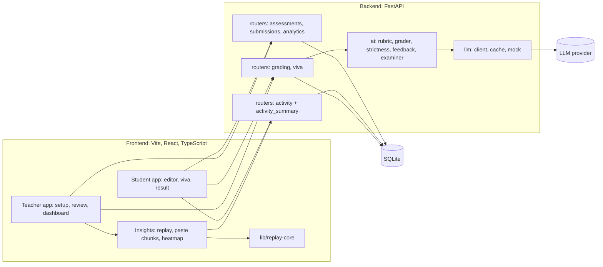
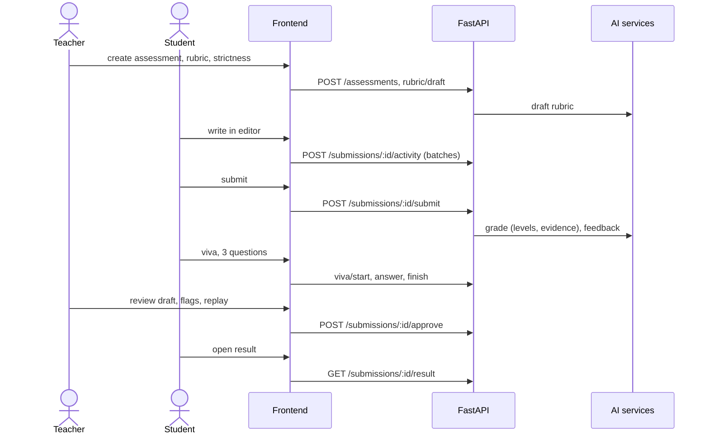

# Architecture

Status: v1, agreed at M0. Changes follow the contract protocol in `AGENTS.md` section 5.

## 1. Goals and principles

Goal: help teachers grade faster, more consistently and more transparently, while making AI shortcuts less rewarding for students. It is a copilot and never replaces the teacher.

1. **AI drafts, teacher decides.** Release needs approval unless the teacher chose auto-release.
2. **Evidence over scores.** Each criterion mark carries a verbatim quote that is machine-verified against the student's text.
3. **Consistency by construction.** One locked rubric and strictness per assessment, names hidden from the AI, temperature 0, marks computed in code, results cached.
4. **Verify learning, not authorship.** No AI detectors. The viva and the writing-process record are evidence for the teacher.
5. **Measure ourselves.** A Trust report quantifies accuracy, consistency and bias (`docs/evaluation.md`).
6. **Demo-safe.** Everything runs locally, and can run offline from cache and fixtures.

## 2. System overview



## 3. Components and ownership

| Component | Responsibility | Owner |
|---|---|---|
| Student app | assessment list, editor with capture, viva screen, result and feedback | Majid |
| Insights | paste chunks, authorship map, heatmap, replay viewer (embedded in teacher review) | Majid |
| replay-core | pure TypeScript: apply events, authorship, heatmap, timeline | Majid |
| Activity API | event ingestion, summary, events for replay | Majid |
| Teacher app | setup, rubric editor, review queue, dashboard, grace marks, trust report page | Ismail |
| Core API | assessments, submissions, approve, result, analytics, grace, seed | Ismail |
| AI services | rubric drafter, grader, strictness engine, feedback, examiner, MCQ | Adeel |
| LLM client | provider call, JSON validation, cache, mock mode | Adeel |
| Evaluation | Trust report scripts and reports | Adeel |
| Integration | `main.py`, smoke test, git tags | Adeel |

## 4. Data model

SQLite through SQLModel. JSON columns hold nested structures. One models file per owner so schema edits do not collide. Changing a schema means everyone runs `python -m app.seed --reset`.

**Core (Ismail, `models/core.py`)**

| Table | Key fields |
|---|---|
| `users` | id, name, role (`teacher` or `student`), classroom_id |
| `classrooms` | id, name, teacher_id |
| `assessments` | id, classroom_id, kind, title, instructions_md, max_marks, pass_mark_pct, rubric (JSON), model_answer_md, strictness, viva_enabled, viva_weight, viva_question_count, viva_time_limit_s, feedback_mode, release_mode, ai_policy, paste_flag_chars, topics (JSON), status, due_at, created_at |
| `questions` | id, assessment_id, kind (`mcq` or `short`), text, options (JSON), answer_key, marks, topic |
| `submissions` | id, assessment_id, student_id, content_md, answers (JSON), status, started_at, submitted_at |
| `grace_adjustments` | id, assessment_id, marks, reason, applied_at, undone_at |

**Grading (Adeel, `models/grading.py`)**

| Table | Key fields |
|---|---|
| `grades` | id, submission_id (unique), status (`ai_draft` or `approved`), strictness_used, prompt_version, model_id, criteria (JSON), ai_total, final_total, overall_confidence, grader_flags (JSON), feedback (JSON), teacher_note, approved_at, released_at |
| `viva_sessions` | id, submission_id (unique), status, questions (JSON), answers (JSON), scores (JSON), understanding, started_at, finished_at |

**Activity (Majid, `models/activity.py`)**

| Table | Key fields |
|---|---|
| `activity_batches` | id, submission_id, session_id, session_started_at, first_seq, last_seq, events (JSON), received_at |
| `paste_declarations` | id, submission_id, session_id, event_seq, source, note, created_at (P2) |

Batches are append-only, so ingestion never read-modifies-writes.

## 5. Scoring, flags and analytics rules

All score math lives in `services/scoring.py` (Ismail). Strictness math lives in `ai/strictness.py` (Adeel). Do not duplicate either.

**Criterion marks (Adeel).** `marks = f(level, minor_errors, ambiguous, strictness)`. Table and code in `docs/ai-spec.md` section 3.

**Final score (Ismail).**
```
work_pct   = work_marks / max_marks            # work_marks = final_total if approved else ai_total
if viva_enabled and viva done:    blended = (1 - w) * work_pct + w * understanding     # w = viva_weight
else:                             blended = work_pct                                    # viva missing: no penalty, flag viva_skipped
final_marks      = blended * max_marks          # 1 decimal
final_with_grace = min(max_marks, final_marks + grace_total)
```
`grace_total` is the sum of grace entries that are not undone. Grace is a separate ledger: the stored score is never overwritten, and students see "includes +N grace marks".

**Flags (computed on read in `services/flags.py`, never stored).**

| Flag | Rule |
|---|---|
| `low_confidence` | grader `overall_confidence` below 0.6 |
| `evidence_unverified` | any criterion has no verifiable quote |
| `injection_attempt` | grader or regex detected instructions inside the submission |
| `needs_manual_grading` | grading failed after retry |
| `weak_viva` | understanding below 0.4 |
| `viva_skipped` | viva enabled but not done when the work is approved |
| `paste_heavy` | `pasted_pct` at least 40, or a `major` paste chunk with `survived_pct` at least 50 (internal moves excluded) |

Grader flags are stored on the grade (`grader_flags`). The rest are derived from viva and activity data.

**Dashboard rules (Ismail).**
- Per assessment: counts (enrolled, submitted, graded, approved, released, pending review), average, median, pass rate, highest, lowest, histogram in 10-point bins, per-topic and per-criterion averages. Basis is `final_with_grace` for approved work and the AI draft otherwise. `final` is true only when every submitted work is approved.
- Class level: trend across assessments by `due_at`, and the attention list.
- Attention reasons: `below_pass_recent` (below pass mark in each of the last 2 graded assessments), `falling_trend` (last 3 scores strictly falling by at least 10 points), `low_understanding` (latest understanding below 0.4), `missing_work` (no submission for a closed assessment). Sorted by number of reasons, then lowest latest score.
- Override stats (live monitoring of the AI): override rate, mean absolute and signed delta in marks, per criterion.

## 6. Key flows



- **A. Setup:** teacher creates an assessment, optionally asks AI to draft a rubric, edits it, picks strictness and options, previews strictness on a sample answer, publishes.
- **B. Write and submit:** student writes in the editor; events stream in batches; submit locks the work and starts grading in the background.
- **C. Viva:** after submit the student answers questions generated from their own text. Understanding is scored 0 to 1.
- **D. Review:** teacher sees the AI draft with evidence, flags, paste chunks and replay. Names are hidden by default (blind mode). Teacher overrides marks if needed, then approves and optionally releases.
- **E. Results and dashboard:** student reads feedback and score. Teacher reads stats, graphs and the attention list, and can add grace marks after previewing the effect.

## 7. Writing-process capture and replay

This is the contract between the editor, the backend summary and the replay. Majid owns it.

### 7.1 Event schema
One JSON object per change or session event (field table in `docs/api-contract.md`).
- Edit events replace `doc[from:to]` with `text`. Positions are UTF-16 code units (JavaScript string indices) in the document immediately before the event is applied. Apply strictly in order of session start, then `seq`.
- Non-edit events (`start`, `end`, `blur`, `focus`, `hidden`, `visible`) have `from = to = 0` and empty `text`.

### 7.2 Capturing from CodeMirror 6
Use an update listener. For every transaction that changes the document, classify by the `userEvent` annotation:

| userEvent | k |
|---|---|
| `input.type`, `input.type.compose`, `input.complete`, `move.drop` | `type` |
| `input.paste` | `paste` |
| `input.drop` | `drop` |
| `delete.cut` | `cut` |
| other `delete.*` | `del` |
| `undo` | `undo` |
| `redo` | `redo` |
| anything else (programmatic) | `type` |

For each change from `tr.changes.iterChanges((fromA, toA, fromB, toB, inserted) => ...)` emit one event with `from = fromB`, `to = fromB + (toA - fromA)`, `text = inserted.toString()`. Iterating in ascending order and using `fromB` makes positions valid for sequential replay. Emit `blur` and `focus` from `window`, and `hidden` and `visible` from `document.visibilitychange`. `t` is milliseconds since session start (`performance.now()`). Buffer events, POST a batch every 3 seconds, on submit, and on `pagehide` (use `navigator.sendBeacon`).

### 7.3 Authorship model
Keep the document as segments `{start, end, tag, src}`. Tags: `T` typed, `P` pasted, `U` restored by undo or redo (counts as typed). `src` is `session_id:seq` of the paste event. On each edit remove the replaced range, then insert `text` tagged by its `k`: `type` gives T, `paste` and `drop` give P, `undo` and `redo` give U.

**Internal paste rule.** A `paste` is INTERNAL (moved text, tagged T, never flagged) when its trimmed text has at least 20 characters and either already appears in the document at that moment or equals the text removed by the most recent `cut` in the session. This stops students being flagged for moving their own paragraphs.

### 7.4 Summary (backend, `activity_summary.py`)
Computed from raw events, never trusted from the client.
- `typed_pct`, `pasted_pct`: share of final characters by tag (T plus U versus P).
- `paste_chunks`: external pastes and drops of at least 40 characters. `survived_chars` is how much of the chunk is still in the final text. `major` means `chars >= assessment.paste_flag_chars`.
- `revision_ratio`: deleted characters divided by inserted characters.
- `active_minutes`: distinct minute buckets with at least one edit. `span_minutes`: first to last event.
- `tab_switches`: count of `hidden` events.
- `heatmap`: buckets of 1 minute (1 hour when the span exceeds 3 hours) with `edits`, `typed_chars`, `pasted_chars`.

**Python gotcha:** positions are UTF-16 units. Keep the document as UTF-16-LE bytes (`str.encode("utf-16-le")`, 2 bytes per unit) so indices match JavaScript. Otherwise emoji and some scripts shift every later position.

### 7.5 Replay (frontend, `lib/replay-core`)
Pure TypeScript, no React inside. API: `applyEvent(state, event)`, `docAt(events, index)`, `authorshipAt(events, index)`, `buildTimeline(events, { maxIdleMs: 5000 })`, `heatmap(events, bucket)`. Store checkpoints every 200 events so scrubbing is instant. Collapse idle gaps over 5 seconds, and gaps between sessions to 1 second with a session label. Controls: play and pause, speed 1x, 2x, 4x, 8x, scrubber, "jump to next paste". Pasted text is highlighted while visible. The replay is a reconstruction from the log, not a screen recording.

### 7.6 Parity fixtures
`fixtures/activity/` holds sample logs with `expected_summary.json`. Both `activity_summary.py` and `replay-core` MUST pass the same files. Required fixtures: typed only, one big paste, paste then heavy edit, cut-and-paste move, emoji text, two sessions, undo and redo.

## 8. AI pipeline (summary)

Details and prompts: `docs/ai-spec.md`.
1. **Grader** classifies each criterion into a level 0 to 4 and quotes evidence. It never outputs marks.
2. **Quote verifier and strictness engine** (code) verify quotes, then compute marks from level, minor errors, ambiguity and strictness.
3. **Feedback writer** turns the graded result into strengths, improvements and a next step.
4. **Examiner** writes viva questions from the student's own submission and scores answers.
5. **Blend** (`scoring.py`) combines work and understanding using the teacher's viva weight.

## 9. Reliability and demo safety

- `MOCK_LLM=1` serves canned outputs from `fixtures/api/llm/`. `VITE_USE_FIXTURES=1` serves canned API responses. Nobody is blocked by the network.
- LLM responses are cached on disk by input hash. Warm the cache by running grading on the demo submissions twice before the demo.
- LLM calls time out at 30 seconds, with one repair retry. The UI always shows progress for grading and viva.
- Grading runs in the background (`GRADE_ON_SUBMIT=1`, `grade-all`), so the demo never waits on it live.
- `python -m app.seed --reset` restores a clean demo state in seconds.
- Everything runs on one laptop. Use a phone hotspot as the network backup. Keep a screen recording of the golden path as the last resort.

## 10. Privacy and ethics

- Capture only inside the editor. No screen recording, webcam or off-app tracking. A visible banner and a "what is recorded" panel tell the student exactly what is stored.
- Student names, emails and IDs never reach the LLM. Activity logs never reach the LLM.
- Writing-process signals and viva scores are flags for a teacher conversation. They never apply a penalty on their own. The only automatic effect is the teacher-set viva weight.
- Blind review mode hides student names in the review queue by default, which also reduces teacher bias.
- Known limits, stated openly: retyping AI text from a second screen defeats paste detection (the viva covers that gap), and a nervous student may score lower in a viva (the teacher sets the weight and sees every answer).

## 11. Stack and conventions

Stack, commands and environment variables live in `.kiro/steering/tech.md`. Repo map lives in `.kiro/steering/structure.md`.

## 12. Decisions

| ID | Decision | Why | Cost |
|---|---|---|---|
| ADR-1 | Contract-first, with fixtures and `MOCK_LLM` | Three people build in parallel without waiting on each other | Contract changes need 15 minutes of coordination |
| ADR-2 | Level-based scoring: the model picks a level and quotes evidence, code computes marks | Strictness becomes transparent, testable and monotonic. A strictness preview costs one LLM call | Level descriptors must be good, so the rubric draft needs teacher review |
| ADR-3 | Verify every evidence quote as a substring of the submission | Catches hallucinated justification and makes review fast | A few valid paraphrased quotes are dropped and flagged |
| ADR-4 | No AI-detector; use the viva plus the writing-process record | Detectors are unreliable and produce false accusations | Retyped AI text is only caught by the viva |
| ADR-5 | Replay rebuilt from the event log, not a screen recording | Cheap, light, less invasive, and reliable on stage | Only sees what happens inside the editor |
| ADR-6 | SQLite and no auth, with a role switcher | Fastest path to a working demo | Not production ready; stated as out of scope |
| ADR-7 | Trunk-based git with directory ownership | Few conflicts, no PR overhead in a one-day build | Needs discipline: rebase often, revert fast |
| ADR-8 | Blind review mode on by default | Directly addresses teacher mood and bias | Teacher must click to reveal names |
| ADR-9 | Server computes the activity summary, the client computes the replay, shared fixtures enforce parity | Summary cannot be tampered with by the client | Two implementations to keep in sync |
| ADR-10 | Grace marks as a separate ledger with preview and undo | Original scores stay auditable | Slightly more UI |

## 13. Out of scope today, and what we would revisit

Logins and roles, LMS integration, voice viva, per-student time multipliers for the viva, multi-class tenancy, a fairness audit on a larger dataset, a secure exam mode, a retention policy for activity logs, plagiarism databases.
