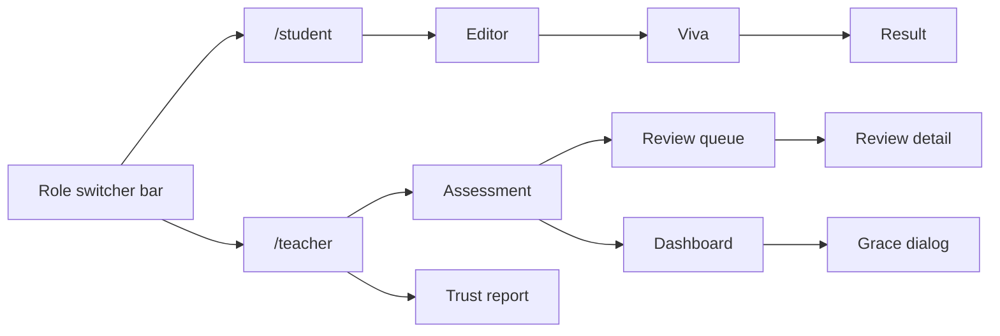

# VivaGrade design

Anti-slop rules in section 13 are adapted from refero_skill (https://github.com/referodesign/refero_skill, MIT) as tightened by OpenDesign; further adapted for VivaGrade.

## 0. Status and how to use

- Version v1, 2026-10-10. Owner: Adeel (reviewer). Author: design agent for Adeel (task DESIGN). Status: proposed, needs Adeel's approval of section 16 before anyone builds on it.
- This file is the visual and interaction source of truth. The spec (docs/api-contract.md, docs/architecture.md) wins on data and behavior. Kiro spec folders have their own design.md files; they are unrelated and MUST cite this file by section number.
- Root DESIGN.md (Apple design analysis, added by a teammate) is reference only and is NOT used. See section 16, contradiction C2.
- Values live only in the :root block in section 7. Everywhere else, use token names.

| Reader | Read first | Then |
|---|---|---|
| Majid (student UI, insights) | 1, 3, 5 (S screens, T06 insights), 6, 7 | 8 to 12, 15 |
| Ismail (teacher UI, ui kit) | 1, 3, 5 (T screens), 6, 7, 15 | 8 to 12 |
| Adeel (review, pitch) | 1, 4, 8, 13, 14 | 16 |
| Any coding agent | 15 (steering block), 7, 9, 13 | the screen you build |

## 1. Design intent

Principles (each has a test):
1. **Evidence beside every number.** A mark never appears without its quote, reasoning and confidence within one eye movement. Test: on T06 a teacher verifies one mark without scrolling or clicking (task budget: 10 seconds, src: task brief).
2. **The teacher's hand is visible.** Everything the AI produced is labelled "AI draft" until a teacher approves it. Test: no AI-produced number or sentence on T06 or T07 lacks that label or an approved state.
3. **Signals, never verdicts.** Flags say what to look at, never what a student did. Test: no UI string contains cheat, plagiarism, suspicious, weak, fail or "AI-written" (grep, section 13).
4. **One thing at a time when the clock runs.** The viva shows one question, one timer, one action. Test: S03 has exactly one primary button on screen.
5. **Survives the back of the room.** Body 16px base, key numbers 56px, nothing under 14px, holds at 125 percent browser zoom. Test: section 14 checks 4 and 5.

Direction: an annotated manuscript on a cool grey desk. The student's own words sit on a white page in a reading serif, and the system speaks in a plain, highly legible sans in the margins. Spend boldness in one place: the margin-note law (section 1, signature moves).

Rejected defaults (pass 2 of the plan; each was what any similar app would get):
| First instinct | Why rejected | Replaced by |
|---|---|---|
| Warm cream paper, high-contrast serif, terracotta pen (the obvious "manuscript" look) | Listed extra tell; looks like a template | Cool grey desk, white page, petrol ink accent |
| Apple-style blue, SF type, dark tiles (root DESIGN.md) | Default blue, font not open-licensed, photo-first layout has no photos here | Petrol accent, OFL fonts, flat light surfaces |
| Blue to green gradient wordmark and dark slate bar (current skeleton in routes.tsx) | Gradient on a primary surface; dark chrome fights the white page | Flat serif wordmark, light bar with a hairline |
| Four to six identical stat tiles | Grid of identical tiles is the dashboard version of "hero, features, pricing" | One 56px headline figure plus a fact row |
| Cards with a colored left border for flags and criteria | Canonical AI dashboard tile | Hairline-divided rows; status as icon plus text |
| Red/amber/green traffic lights on marks | Color-only, and implies verdict | Neutral numbers; semantic color only on chips with text |
| Progress rings for confidence and timer | Hard to read at distance, poor semantics | Native meter and progress with a number |
| Sparkle icon next to "AI" | Banned emoji-style icon tell | Text chip "AI draft" |
| Confetti on approve | Decoration, not feedback | Quiet confirmation line with the totals |

Signature moves (each under one hour):
- **Bold visual move, the margin-note law.** Serif means a person wrote it (student text, quotes, teacher notes) and screen titles. Sans means the interface or the AI. Quotes are highlighted in the student's text with numbered markers that match numbered rows in the right-hand margin. Test: AI reasoning is never serif; a quote is never sans.
- **Voice.** Buttons name outcomes: "Approve and release", "Apply +2 marks to 12 students", "Start viva".
- **Micro-interaction.** Selecting a criterion scrolls its quote into view and flashes the highlight once (400ms). Reduced motion: no flash, the highlight gets a 2px outline instead. One orchestrated moment: the final score counts up once on S04 (700ms).
- **Product-specific detail.** The footer of T06 reads "No shortcut approves a grade." next to the key hints.

Screenshot test: a viewer should recognise VivaGrade by the serif student text with numbered highlights beside a sans mark column, on a grey desk. If a screen lacks that law or the petrol accent, it is a template.

## 2. Users, contexts and tasks

Budgets marked ASSUMPTION are targets for QA, not from the spec.

| Persona | Context | Top tasks and budget | Risks |
|---|---|---|---|
| Teacher | Desk, 1366 px laptop, reviewing many scripts | Verify one mark: 10 s (src: brief). Review one submission and decide: 2 min, ASSUMPTION. Set strictness after a preview: 1 min, ASSUMPTION. Add grace marks with preview: 3 clicks plus a reason. Find who needs attention: 1 glance, no clicks | Automation bias (approving without looking), reading flags as proof, name bias |
| Student | Own device, 768 px or wider, 30 to 60 min writing, then a timed viva | Start writing: 2 clicks from the list. Submit: 1 click plus a confirm. Understand viva rules: under 10 s, no paragraph. Read feedback: score first, one next step last | Anxiety about being watched, timer pressure, losing work |
| Presenter and judges | Projector, 125 percent zoom, 2 minute walk (src: demo-script) | See each of the six golden-path steps land in 15 to 35 s each (src: demo-script table) | Small type, slow LLM waits, a screen that needs explaining |

Lenses applied (named where they change a decision): Nielsen 1 status visibility (LLM waits, autosave), 3 user control (undo grace, cancel dialogs), 5 error prevention (approve confirm, preview before apply), 6 recognition over recall (labels instead of codes); cognitive load (viva one question at a time); Hick and Fitts (viva has one primary target, 48px tall); WCAG 2.2 AA; human-AI guidance (calibrated trust, evidence, easy override, section 8).

## 3. Information architecture



| Route | Screen | Role |
|---|---|---|
| `/` | redirect to `/student` or `/teacher` by current role | both |
| `/student` | S01 assessment list | student |
| `/student/assessments/:assessmentId` | S02 editor (POST submissions, idempotent) | student |
| `/student/submissions/:submissionId/viva` | S03 viva (rules, questions, done) | student |
| `/student/submissions/:submissionId/result` | S04 result | student |
| `/teacher` | T01 assessment list | teacher |
| `/teacher/assessments/:assessmentId` | T02 settings, rubric, strictness (tabs) | teacher |
| `/teacher/assessments/:assessmentId/review` | T05 review queue | teacher |
| `/teacher/submissions/:submissionId` | T06 review detail | teacher |
| `/teacher/assessments/:assessmentId/dashboard` | T07 dashboard, T08 grace dialog | teacher |
| `/teacher/trust-report` | T09 trust report | teacher |

Navigation rules:
- The role bar (S00) is one 56px light bar on every page: wordmark (serif), current user, role select, a link to the other role's home. It never uses a gradient. Changing role reloads (existing behavior) and lands on that role's home.
- Teacher pages show a breadcrumb: Assessments, assessment title, current screen. Student pages show a single "Back to my work" link.
- The viva has no back link while a question is live (Why: leaving mid-question must not be a casual click; closing the tab is counted, section 5.2).
- Deep links work: T06 opened directly still starts with names hidden.
- Fixture mode (`VITE_USE_FIXTURES=1`) shows a chip "Fixtures" in S00; `mock_llm` true from `/api/v1/health` shows "Cached AI results" (health is Adeel's endpoint, extra field `mock_llm`).

## 4. Golden path and demo choreography

| Step (src: AGENTS 7) | Demo time (src: demo-script) | Screens | Polish priority |
|---|---|---|---|
| 1 Teacher sees settings | 0:00 to 0:15 | T02 strictness preview | High: four columns land the "consistency" claim |
| 2 Student writes, pastes, submits | 0:15 to 0:45 | S02, then S03 start | Medium: banner and paste must be visible on camera |
| 3 Viva | inside 0:15 to 0:45 | S03 | High: rules readable in 3 seconds, timer legible |
| 4 Review, approve, release | 0:45 to 1:20 | T05 blind mode, T06 | Highest: evidence highlights, flags, replay jump, approve confirm |
| 5 Student result | 1:20 to 1:35 | S04 | High: count-up, feedback cards |
| 6 Dashboard, grace marks, Trust report | 1:35 to 2:00 | T07, T08, T09 | High: headline figure, preview then apply |

Spend polish in this order when time is short: T06, T07, S03, S04, T02, then everything else. Cut order follows docs/roadmap.md "Priorities and cut lines".

## 5. Screens

Priorities follow docs/roadmap.md. Owners follow AGENTS.md section 3.

| ID | Route | Owner | Pri | Purpose | Primary action | Endpoints | 
|---|---|---|---|---|---|---|
| S00 | all | Majid | P0 | Role bar, mode chips | Switch role | GET /users, GET /health |
| S01 | /student | Majid | P0 | List assessments with status | Continue writing | GET /assessments |
| S02 | /student/assessments/:id | Majid | P0 | Write, autosave, record, submit | Submit for marking | POST /assessments/:id/submissions, PUT /submissions/:id, POST .../submit, POST .../activity |
| S03 | .../viva | Majid | P0 | Rules, three timed questions | Submit answer | POST viva/start, viva/answer, viva/finish |
| S04 | .../result | Majid | P0 | Score, understanding, feedback | Back to my work | GET /submissions/:id/result |
| T01 | /teacher | Ismail | P0 | List assessments, counts | Open assessment | GET /assessments |
| T02 | /teacher/assessments/:id | Ismail | P0 | Settings, rubric view, strictness preview | Save settings, Publish | GET/PATCH /assessments/:id, POST publish, POST strictness/preview |
| T03 | tab in T02 | Ismail | P1 | Rubric editor, draft rubric | Draft rubric | POST rubric/draft |
| T05 | .../review | Ismail | P0 | Queue with flags, blind mode, grading progress | Open next to review | GET submissions, POST grade-all, GET grading-status |
| T06 | /teacher/submissions/:id | Ismail (insights: Majid) | P0 | Verify, override, approve, release | Review and approve | GET grade, activity summary, viva; POST approve |
| T07 | .../dashboard | Ismail | P0 | Stats, charts, attention, override stats | Add grace marks | GET stats, performance, attention, override-stats |
| T08 | dialog on T07 | Ismail | P0 | Preview then apply or undo grace | Apply +N marks | POST grace/preview, apply, undo |
| T09 | /teacher/trust-report | Ismail | P1 | Measured accuracy, bias, limits | none (read) | GET /evaluation/trust-report |
| P2 | quiz flow, feedback regenerate, paste declaration, per-topic practice | Majid, Ismail | P2 | One line each, not designed today | | |

The strictness preview lives inside T02 (tab), so there is no separate T04.

### 5.1 T06 review detail (hardest screen)

```
+----------------------------------------------------------------------------------------------+
| Assessments / A1 Hash table collisions / Review        Names hidden [Show names]  Student 03, 3 of 12 |
+----------------------------------------------------------------------------------------------+
| Check these first:  [! Large pasted text]  [! Low viva score]       AI draft, not yet approved |
+------------------------------------------------+---------------------------------------------+
| Student 03's work (serif 18/1.7, max 68ch)     | Totals (sticky)                              |
| Typed 41.2% [=======......hatched pasted] 58.8%|  AI draft 15.5   Your total 15.5 of 20       |
|                                                |  Viva understanding 35%  (3 of 3 answered)   |
| ...a collision happens when [1 two keys map    +---------------------------------------------+
| to the same index] and chaining stores...      | 1 Concept accuracy          4.0 / 5   Level 3 |
| [2 lookups are fast] and that is all it says   |   AI reasoning (sans): Defines collisions... |
| about complexity. (hatched: pasted passage)    |   Quote 1 in text    Confidence 82% High      |
|                                                |   [Change marks]                              |
+------------------------------------------------+ 2 Examples and chaining      3.5 / 5   Level 3 |
| Tabs: Pasted text | Replay | Activity           |   ... rows 3 and 4 same anatomy               |
| list of chunks: 1,240 chars, 95.2% kept [Jump] +---------------------------------------------+
|                                                | Teacher note (serif)  [..............]       |
+------------------------------------------------+---------------------------------------------+
| J next  K previous  [ ] criteria. No shortcut approves a grade.     [Back to queue] [Review and approve] |
+----------------------------------------------------------------------------------------------+
```
Hierarchy: (1) signals bar, (2) criterion rows with the quote visible, (3) the student's text, (4) totals, (5) process evidence tabs.
- The signals bar lists each active flag as a chip (section 6) plus one line "What to check" under the chip row when a chip is focused or selected.
- Criterion row anatomy: number, name, mark "4.0 / 5", level "Level 3 of 4", confidence band, AI reasoning, first verified quote (serif, evidence highlight), "Change marks". Selecting a row scrolls the text to its first quote and flashes it.
- Override: stepper in 0.5 steps (src: contract), shows "AI gave 4.0", the delta "-0.5 from AI draft", optional note. Totals update live: "Your total 15.5 to 15.0".
- Review and approve opens a native dialog (section 6, approve dialog). Approve is never pre-selected or default-focused.
- Process evidence: P0 = paste chunk list and the typed/pasted bar. P1 = replay, authorship map, heatmap (src: roadmap cut order).

### 5.2 S03 viva

```
+----------------------------------------------------------------------+
| VivaGrade                                    Ayesha K., student   [role]  |
+----------------------------------------------------------------------+
|  Question 2 of 3                                                      |
|  Time left  [progress ==============================-------]  0:58   |
|                                                                      |
|  You wrote: "open addressing slows down when the table fills up"      |
|  Why does that happen?   (sans 28px semibold)                         |
|  +----------------------------------------------------------------+  |
|  | Your answer. One to three sentences is enough.                  |  |
|  +----------------------------------------------------------------+  |
|  Paste is off here. Leaving this tab is counted (0 so far).          |
|  [ Submit answer ]  (48px tall)                       Answered 1, 1 to go |
+----------------------------------------------------------------------+
| Recorded: your answer, time taken, tab switches, paste tries. Not recorded: screen, camera, other apps. |
+----------------------------------------------------------------------+
```
Before question 1, a rules screen shows exactly three lines, each with an icon, no paragraph: "3 questions, 90 seconds each" (src: contract viva_question_count, viva_time_limit_s); "Paste is off in answer boxes"; "Leaving this tab is counted and shown to your teacher". Then one button, "Start viva". Nothing starts the clock before that click.
- The timer is a native `progress` plus text. At 30 s and 10 s left, text turns bold and a polite live region announces "30 seconds left". The bar never changes color.
- At 0:00 the typed text is submitted as the answer and the next question appears (ASSUMPTION, open question Q1: spec says a timed-out answer scores 0).
- Pasting is blocked in the box. A blocked attempt shows "Paste is off here" and sets `pasted` true (ASSUMPTION, Q2).
- WCAG 2.2.1 plan for today: teacher can lengthen `viva_time_limit_s` for the whole class on T02; the rules screen states the limit before starting; a visible text countdown; no timer on the rules screen. Per-student extra time is out of scope (src: brief) and is recorded as Q1.
- After question 3: "Done. Your teacher will review your work." with a link to S04 if released, else to S01. The student never sees the viva score, only understanding after release (src: contract VivaResult shows understanding).

### 5.3 T07 dashboard

```
+--------------------------------------------------------------------------------+
| A1 Hash table collisions       [Not final: 3 of 12 await your review] [Add grace marks] |
+--------------------------------------------------------------------------------+
| 63.4%  average, draft basis (serif 56px)   Median 65.0  Pass rate 83.3%  Highest 92.0  Lowest 31.0 |
| Graded 12 of 12 | Approved 9 | Released 9 | Awaiting review 3     [stacked bar, labelled] |
+---------------------------------------------+----------------------------------+
| Score spread (10 bins, count above each bar)| Needs attention (2)              |
| pass mark line labelled "Pass mark 50%"     |  Bilal R.  Below pass mark in the last 2; Scores falling |
|                                             |  Ayesha K.  Low viva score in latest     |
+---------------------------------------------+----------------------------------+
| By topic, lowest first, value on each bar   | Class over time, line + pass rate |
+---------------------------------------------+----------------------------------+
| Your marking against the AI: you changed 3 of 12 marks (25.0%), on average 0.5 lower. |
+--------------------------------------------------------------------------------+
```
Names are demo data. Rules: the headline says "final" only when `final` is true (src: contract AssessmentStats); otherwise "draft basis". Basis note: "Approved work uses your marks; the rest uses the AI draft" (src: architecture 5). Charts section 6.

### 5.4 Other P0 and demo-used P1 screens

| ID | Layout and hierarchy |
|---|---|
| S00 | 56px bar. Left wordmark. Right: user name, role select (label "Viewing as"), mode chips. 1 accent use: none; the select has a visible border. |
| S01 | Max width 72rem. One row per assessment: title (serif 22px), due date, status chip, one button. Open item first, closed last. |
| S02 | Header: title, "AI use: allowed with disclosure" (src: contract ai_policy), save status. Recording banner (section 6) under the header. Editor left, preview toggle right (below 1024 px preview is a tab). Footer: word count, "Submit for marking". |
| S04 | Left: score "17.2 of 20" (56px serif, counts up), line "includes +2.0 grace marks" when `grace_marks` above 0, understanding meter "Understanding 72%". Then "What went well" (up to 3), "What to improve" (up to 3), "Your next step". Quote in serif with highlight. In `hints` mode improvements show the hint only; in `full` mode the explanation is in a closed `details` labelled "Show explanation". |
| T01 | Table: title, kind, status chip, submitted n of enrolled, awaiting review n. Row link opens T02. |
| T02 | Tabs: Settings, Rubric, Strictness. Settings form groups: Strictness, Viva (weight, question count, time per question), Feedback mode, Release mode, AI policy, Paste threshold. Sticky footer: Save settings, Publish. Strictness tab: section 6 selector and preview. Rubric locked notice after first grade. |
| T05 | Toolbar: "Names hidden" switch, "Grade all submissions" with progress. Table (section 6). Default sort: flagged first, then lowest confidence. |
| T09 | Page title, then the limits box (pilot, sample size, raters) ABOVE the numbers. Four figures as paired AI versus human rows, then 6 probe rows, strictness ordering row. |

### 5.5 States per screen (loading, empty, error, partial, success)

| Screen | Loading | Empty | Error | Partial | Success |
|---|---|---|---|---|---|
| S01 | Three row skeletons | "Nothing assigned yet. Your teacher has not opened an assessment." | "Could not load your assessments. Check your connection, then Retry." | Closed items greyed, still listed | List with one primary button |
| S02 | Editor skeleton, "Opening your draft" | New draft with the instructions shown | Save error: "Not saved. Trying again in 5 s. Your text stays here." Submit 409: "Already submitted. You can read it but not edit." | Offline: banner "Offline. Recording continues and sends when you reconnect" | "Saved 12:41", submit confirm then S03 start |
| S03 | "Preparing your questions" with indeterminate progress (up to 30 s, src: contract) | n/a | llm_unavailable: "Questions could not be prepared. Retry. If it fails again, tell your teacher. Your work is submitted." | Answer send failed: "Answer not sent. Retry" and keep the text | Done screen |
| S04 | Skeleton, no number | not_released: "Your teacher has not released your result yet." | "Could not load your result. Retry." | Viva skipped: understanding row reads "Not taken" | Count-up, feedback cards |
| T01 | Row skeletons | "No assessments yet. Create the first one." | "Could not load assessments. Retry." | Draft items marked "Draft, not visible to students" | Table |
| S00 | Bar renders with "Loading users" in the select | n/a | "Could not load users. Retry." | Fixtures chip shown | Select lists seeded users |
| T03 | Editor skeleton | "No criteria yet. Draft a rubric or add one." | "Rubric not drafted. Try again, or write criteria yourself." | Marks sum off: "Criteria add up to 18, assessment is 20" | "Marks add up to 20 of 20" |
| T02 | Form skeleton | n/a | PATCH failed: "Settings not saved. Fix the marked fields." | Rubric null: "No rubric yet. Draft one or add criteria." | "Saved" inline, Publish enabled |
| T05 | Row skeletons | "No submissions yet." | "Could not load submissions. Retry." | Grading: rows fill as done, "Graded 7 of 12" | Sorted queue |
| T06 | Two-column skeleton | No grade: "Not graded yet. Grade this submission." button | llm_unavailable: "The AI could not finish this grade. Nothing was saved. Try again." plus flag "AI could not grade this" | No activity: "No writing record for this work."; no viva: "Viva not taken." | Full screen |
| T07 | Skeleton figure and chart frames | "No submitted work yet. Charts appear after the first submission." | "Could not load stats. Retry." | Not final banner; charts use draft basis | Final: chip "Final" |
| T08 | Preview button spinner, up to 2 s | n/a | "Grace marks not applied. Retry." | Preview shown, Apply enabled; capped note | Ledger row with Undo |
| T09 | Skeleton | "No trust report yet. Run the evaluation to create it." (ASSUMPTION: text) | "Could not load the report. Retry." | Missing sections say "Not measured" | All sections |

## 6. Components

| Component | Owner | Used on | Pri |
|---|---|---|---|
| Button, IconButton, Chip, Banner, Dialog, Meter, Progress, Tabs, FormField, Table, EmptyState, ErrorState, Skeleton, Icon | Ismail (components/ui) | all | P0 |
| RecordingBanner, SaveStatus, EditorFrame | Majid (components/student) | S02 | P0 |
| VivaCard, Countdown, RulesPanel | Majid | S03 | P0 |
| ResultScore, FeedbackCard | Majid | S04 | P0 |
| StrictnessSelector, StrictnessPreview | Ismail | T02 | P1 |
| RubricEditor | Ismail | T03 | P1 |
| CriterionRow, EvidenceText, FlagChip, ConfidenceMeter, ApproveDialog, TotalsPanel | Ismail | T06 | P0 |
| ReviewTable, BlindToggle | Ismail | T05 | P0 |
| PasteChunkList, TypedPastedBar | Majid (features/insights) | T06 | P0 |
| ReplayViewer, AuthorshipMap, ActivityHeatmap | Majid | T06 | P1 |
| HeadlineFigure, Histogram, TopicBars, TrendChart, AttentionList, OverrideSummary | Ismail | T07 | P0 (TrendChart, AttentionList P1) |
| GraceDialog, GraceLedger | Ismail | T07, T08 | P0 |
| TrustFigures | Ismail | T09 | P1 |

Specs for critical components (props are sketches; types come from docs/api-contract.md):

| Component | Anatomy and props | States | Behavior and accessibility |
|---|---|---|---|
| StrictnessSelector | Radio group of four labelled Lenient, Normal, Strict, Very strict, each with one plain line (src: ai-spec 3). Props: value, locked, onChange | default, selected, locked ("Locked: grading has started"), saving | Native `radio` in a `fieldset` with legend "Strictness". Changing it never triggers grading. |
| StrictnessPreview | Textarea "Sample answer", button "Preview four strictness levels", then four columns (Lenient to Very strict) each with total "17.5 of 20" and per-criterion marks; a one-axis dot plot of the four totals with direct labels. Props: preview, maxMarks | idle, running (progress, 30 s limit), result, error | Totals MUST read non-increasing left to right (src: contract); if not, show "Preview inconsistent, report to Adeel" and hide the plot. Table markup with row headers. Note under result: "One grading pass, four strictness policies." Selecting a column does not lock; the selector above does. |
| RubricEditor | List of criterion editors: name, description, max marks, topic, five level fields (0 to 4) in a vertical stack, sum bar "Marks add up to 20 of 20". Props: rubric, locked | clean, invalid sum (blocks Save), drafting, locked | Sum mismatch disables Save with text "Criteria add up to 18, assessment is 20". "Draft rubric" button shows progress and replaces only after the teacher confirms "Replace current criteria?". |
| CriterionRow | See 5.1. Props: criterion, grade criterion, selected, onSelect, onOverride | collapsed, selected, overridden, unverified (no quote) | `button` row with `aria-expanded`; marker number is text, not color. Unverified shows "No verified quote" and confidence "Low". Override stepper: `input type=number step=0.5`, min 0, max criterion max (src: contract). Override changes totals live and shows "Changed from AI draft: -0.5". |
| EvidenceText | Student markdown rendered in serif; verified quotes wrapped in `mark` with number badge; offsets from `evidence.start/end` (UTF-16, src: contract); pasted ranges get a dashed underline | normal, quote selected (flash), pasted, no activity data | `mark` elements carry `aria-label="Evidence 1 for Concept accuracy"`. Highlight uses evidence tokens plus a 2px bottom edge so it survives grayscale. |
| FlagChip | Icon + label + optional "What to check" line. Labels: low_confidence "Low AI confidence"; evidence_unverified "Quote not found in text"; injection_attempt "Text tries to instruct the AI"; needs_manual_grading "AI could not grade this"; weak_viva "Low viva score"; viva_skipped "Viva not taken"; paste_heavy "Large pasted text" | default, focused, selected | Chip text always present. Tone: warn for paste_heavy, low_confidence, viva_skipped, evidence_unverified; danger only for injection_attempt and needs_manual_grading. Under selection: "Check the pasted passages and the replay, then talk to the student before deciding anything." (paste_heavy). Never a tooltip-only explanation. |
| ConfidenceMeter | Native `meter` 0 to 1 plus text "82% High". Bands: High 0.8 and up (ASSUMPTION), Medium 0.6 to 0.79, Low below 0.6 (src: architecture 5) | high, medium, low | Fill uses ink and the band is text; no traffic-light color. `aria-label="AI confidence, 82 percent, high"`. |
| ReviewTable | Columns: label (or name when revealed), status, AI total, understanding, confidence, signals (chips, up to 2 then "+n"), submitted. Props: rows, namesVisible | loading, grading (row shows "Grading"), flagged, selected | Label "Student 03" always shown; name column appears only when revealed. Row is a link with full-row hit area. `aria-sort` on sortable headers. |
| BlindToggle | Switch "Names hidden" (default on). Turning it off opens a dialog: "Show student names? Seeing who wrote the work can change how you mark it." Buttons "Keep names hidden" (default focus) and "Show names" | hidden, revealing, revealed | Revealed state keeps a persistent info chip "Names visible" and a "Hide names" button. State persists for the browser session only. |
| ApproveDialog | Native `dialog`. Shows: your total, overrides count, each active flag with a checkbox "I looked at this" (only for flags), buttons "Back to review" (default focus), "Approve", "Approve and release" | closed, open, flags unchecked (both approve buttons disabled), sending, error | Escape closes. Never pre-selected. If `release_mode` is `auto` the release button reads "Approve (releases automatically)". Result line: "Approved. Student 03 can see 15.5 of 20 now." |
| PasteChunkList | Rows: time, chars, "95.2% kept", Major chip when `major`, button "Jump in replay" (P1). Footer line: Typed 41.2%, Pasted 58.8% with a TypedPastedBar | empty ("No large pasted text"), list | Bar segments are text-labelled; pasted segment uses hatch pattern from an SVG `pattern`, not a gradient. Internal moves are excluded (src: architecture 7.3), so say "Moved text is not counted." |
| ReplayViewer (P1) | Text view with highlighted pasted text, controls: play/pause, speed 1x 2x 4x 8x, scrubber, "Skip idle", "Jump to next paste"; timeline marks pastes with a text label list below | paused, playing, at paste, empty | Scrubber is `input type=range` with `aria-valuetext` "Minute 7 of 190, paste event". Controls are buttons with names; Space toggles play. Note under viewer: "Reconstructed from the writing record, not a recording." |
| AuthorshipMap (P1) | Thin vertical or horizontal strip of the final text, typed segments in chart-1, pasted in chart-2 with hatch; legend with percentages | default, hover shows chars | Text equivalent: "Typed 41.2%, pasted 58.8%". Segments focusable in order. |
| ActivityHeatmap (P1) | Row of bucket cells (minute or hour, src: contract bucket) on the heat ramp with a 1px outline around the strip and a legend | default, empty | Not color-only: summary line "Busiest minute 07:19, 34 active minutes". Each cell has `title` and is reachable as a table row. |
| VivaCard | See 5.2. Props: question, onSubmit, secondsLeft | idle, answering, sending, timed out, error | Textarea with visible label, `aria-describedby` rule text; paste/drop/contextmenu paste blocked; blur/hidden counted. Targets 48px. |
| FeedbackCard | Title (what went well or what to improve), text (sans), quote (serif, highlight), optional hint, optional details "Show explanation" | strength, improvement, hint-only | One card per item, no colored borders; icon (check or pencil) plus heading text distinguishes them. |
| HeadlineFigure | 56px serif number, label "average, draft basis" or "average, final", fact row as `dl` | draft, final | `dl` pairs terms and values. |
| Histogram | Recharts bar, 10 bins, count label on every bar, pass-mark rule labelled, y axis hidden because counts are labelled | loading, empty, ready | `figure` + `figcaption`, "Show as table" `details` with the 10 counts. Bars use chart-1 only. |
| TopicBars | Horizontal bars sorted lowest first with value and n at bar end | ready | Table equivalent. Single series so no legend. |
| TrendChart (P1) | Line chart over assessments by due date: class average (chart-1, solid) and pass rate (chart-2, dashed); end-of-line labels instead of legend | ready | Table equivalent. Dashes differ so grayscale works. |
| AttentionList | Rows: name, reasons as plain-language chips: below_pass_recent "Below pass mark in the last 2", falling_trend "Scores falling over 3", low_understanding "Low viva score in latest", missing_work "No submission" | empty ("No one needs attention right now."), list | Reasons always visible (not in a tooltip). Heading says "Needs attention", never "weak". Each row ends with the latest scores as text. |
| OverrideSummary | One sentence built from OverrideStats: "You changed 3 of 12 marks (25.0%). On average your marks were 0.5 lower than the AI draft." | no overrides: "You have not changed any AI marks yet." | Sign of `mean_signed_delta_marks` picks "lower" or "higher". |
| GraceDialog | Fields: marks (step 0.5), reason (required). Button "Preview effect". Preview panel: before and after average and pass rate, affected students, "1 student reaches the maximum and is capped". Then "Apply +2 marks to 12 students". Ledger lists entries with "Undo" | empty ledger, previewed, stale (inputs changed, Apply disabled), applying, error | Apply is disabled until a preview exists for the current values. Undo needs no confirm because it is reversible: it adds `undone_at` (src: contract). Text states "Original scores are not changed." |
| RecordingBanner | Persistent slim bar: icon + "Recording in this editor: what you type, paste and delete, and when you leave this tab." + "Not recorded: your screen, camera, other tabs." + button "What is recorded" opening a dialog listing fields | collapsed (never hidden), open dialog | Always visible while writing (src: architecture 10). Text plain, no legal tone. |
| TrustFigures | Paired rows: "AI versus human markers" and "Human versus human" for MAE and QWK; consistency "mean range 0.3 marks over 5 runs"; probes "5 of 6 passed" with a row per probe; strictness ordering. Numbers in contract examples are placeholders: render only real report values | ready, section not measured | Limitations list sits above the figures. A worse-than-human result gets a neutral row and the sentence "AI is further from the markers than they are from each other." No success badge. |

## 7. Design system

Fonts: Newsreader (display and human text) and Atkinson Hyperlegible (UI), both SIL OFL 1.1 (verified on npm, versions 5.3.0). Self-hosted through `@fontsource/newsreader` (weights 400, 600, italic 400) and `@fontsource/atkinson-hyperlegible` (400, 700, italic 400), imported in `frontend/src/styles/tokens.css`. Both are new dependencies (section 15). Why: Atkinson was drawn for character distinction at distance; Newsreader was drawn for reading text on screens.

```css
:root {
  /* surfaces */
  --desk: #EEF1F2;
  --page: #FFFFFF;
  --sunken: #E3E8EA;
  /* ink */
  --ink: #1A2E35;
  --ink-soft: #46585F;
  --ink-disabled: #8A979C;
  /* lines */
  --line: #CBD3D6;
  --line-strong: #6F8187;
  /* accent: the teacher's hand */
  --accent: #0B5E6E;
  --accent-hover: #084A57;
  --on-accent: #FFFFFF;
  --accent-wash: #D9EAEE;
  /* semantic */
  --ok: #1E6B3C;       --ok-wash: #E2F1E6;
  --warn: #7A4B00;     --warn-wash: #FCF0D2;
  --danger: #A3262A;   --danger-wash: #FBE3E2;
  --info: #2C5C88;     --info-wash: #E3EDF7;
  --evidence-wash: #FFE98A;
  --evidence-edge: #8A6D00;
  /* data viz */
  --chart-1: #0E6577;
  --chart-2: #C9680F;
  --chart-3: #5B6B73;
  --heat-1: #D5E6EA; --heat-2: #A6CCD4; --heat-3: #6AA7B4; --heat-4: #2F7F90; --heat-5: #0D6073;
  /* focus */
  --focus: var(--ink);
  /* type */
  --font-display: "Newsreader", Georgia, "Times New Roman", serif;
  --font-ui: "Atkinson Hyperlegible", system-ui, "Segoe UI", sans-serif;
  --font-mono: ui-monospace, "Cascadia Mono", Consolas, monospace;
  --fs-sm: 0.875rem; --fs-base: 1rem; --fs-md: 1.125rem; --fs-lg: 1.375rem;
  --fs-xl: 1.75rem;  --fs-2xl: 2.25rem; --fs-stat: 3.5rem;
  --lh-body: 1.5; --lh-read: 1.7; --lh-head: 1.2;
  /* shape */
  --r-mark: 2px; --r-control: 6px; --r-panel: 4px; --r-dialog: 12px;
  /* elevation */
  --shadow-sticky: 0 1px 0 var(--line), 0 6px 12px -8px color-mix(in srgb, var(--ink) 30%, transparent);
  --shadow-dialog: 0 16px 40px -12px color-mix(in srgb, var(--ink) 35%, transparent);
  /* motion */
  --dur-fast: 120ms; --dur-base: 200ms; --dur-flash: 400ms; --dur-count: 700ms;
  --ease-out: cubic-bezier(0.2, 0.8, 0.2, 1);
}
```

Heat ramp: --heat-5 is a separate token from --accent on purpose (charts never use --accent). Display-mode rule (not a token block): `@media (prefers-reduced-motion: reduce)` sets all `--dur-*` to 0.01ms and removes the count-up.

Tailwind theme mapping (Tailwind 4 is installed, see C1; every value is a variable):
```css
@import "tailwindcss";
@theme inline {
  --color-desk: var(--desk);          --color-page: var(--page);       --color-sunken: var(--sunken);
  --color-ink: var(--ink);            --color-ink-soft: var(--ink-soft);
  --color-line: var(--line);          --color-line-strong: var(--line-strong);
  --color-accent: var(--accent);      --color-accent-hover: var(--accent-hover);
  --color-on-accent: var(--on-accent); --color-accent-wash: var(--accent-wash);
  --color-ok: var(--ok);  --color-ok-wash: var(--ok-wash);  --color-warn: var(--warn);  --color-warn-wash: var(--warn-wash);
  --color-danger: var(--danger); --color-danger-wash: var(--danger-wash); --color-info: var(--info); --color-info-wash: var(--info-wash);
  --color-evidence: var(--evidence-wash); --color-evidence-edge: var(--evidence-edge);
  --color-chart-1: var(--chart-1); --color-chart-2: var(--chart-2); --color-chart-3: var(--chart-3);
  --font-serif: var(--font-display);  --font-sans: var(--font-ui);
  --radius-mark: var(--r-mark); --radius-control: var(--r-control); --radius-panel: var(--r-panel); --radius-dialog: var(--r-dialog);
}
```
If the team stays on Tailwind 3, move the same names into `theme.extend.colors` as `var(--name)` strings.

Type scale (roles, weight):
| Role | Token | Font | Weight | Use |
|---|---|---|---|---|
| Figure | --fs-stat | display | 600 | Headline figure, S04 score |
| Page title (h1) | --fs-2xl | display | 600 | One per screen |
| Section title (h2) | --fs-lg | display | 600 | Panels |
| Question | --fs-xl | ui | 700 | Viva question only |
| Human text | --fs-md at --lh-read | display | 400 | Student text, quotes, teacher notes |
| Body | --fs-base at --lh-body | ui | 400 | Everything else |
| Label, caption | --fs-sm | ui | 400 or 700 | Table headers, chips, helper text |
Rules: no size below --fs-sm; h1 and h2 use `var(--font-display)`; numbers in tables use `font-variant-numeric: tabular-nums`; line length of human text max 68ch; sentence case everywhere, no all-caps labels.

Spacing: Tailwind default 4px scale, allowed steps 1, 2, 3, 4, 6, 8, 12, 16 (4 to 64px). Panel padding 16 or 24. Radius: marks and chips --r-mark or full pill for status chips only; controls --r-control; panels --r-panel; dialogs --r-dialog. Why: four radii by role so no single radius covers everything.

Elevation: panels have none (1px --line border). Sticky headers use --shadow-sticky; dialogs use --shadow-dialog. No other shadows.

Motion: state changes use --dur-fast; dialog open --dur-base (fade only); flash --dur-flash; count-up --dur-count. Buttons move 2px down on press (`translate`). No entrance animations on sections or cards. Reduced motion removes flash, count-up and press shift.

Icons: monoline, 1.75px stroke, `currentColor`, 20px (24px in viva), always paired with text except the close button (has an accessible name). Needed set (16): check, x, triangle-alert, info, clock, eye, eye-off, lock, pencil, undo, play, pause, skip-forward, clipboard, chevron-down, circle-help. Source: lucide-react (ISC) as a new dependency for approval; fallback is local inline SVG in `components/ui/Icon.tsx` (no dependency). Remove the Vite template `public/icons.svg` sprite usage.

Data-viz: series colors chart-1 (teal), chart-2 (orange), chart-3 (grey), chosen for color-blind separation by hue and lightness (blue-green vs orange; computed lightness separation below). Rules: max 2 series per chart; label lines at their ends; label bar values directly; dashed versus solid as a second cue; always offer "Show as table".

Contrast (computed with relative luminance, ratio = (L1 + 0.05) / (L2 + 0.05), throwaway script, not committed):
| Pair (text on background, or boundary) | Ratio | Needs | Result |
|---|---|---|---|
| ink on desk / page / sunken | 12.45 / 14.13 / 11.44 | 4.5 | pass |
| ink on accent-wash / evidence-wash | 11.41 / 11.62 | 4.5 | pass |
| ink-soft on desk / page / sunken / accent-wash | 6.56 / 7.44 / 6.02 / 6.01 | 4.5 | pass |
| on-accent on accent / accent-hover | 7.39 / 9.87 | 4.5 | pass |
| accent on page / desk / accent-wash | 7.39 / 6.51 / 5.97 | 4.5 | pass |
| ok on ok-wash, warn on warn-wash, danger on danger-wash, info on info-wash | 5.57, 6.54, 5.99, 5.92 | 4.5 | pass |
| ok, warn, danger, info on page | 6.51, 7.41, 7.32, 7.02 | 3 (icon) | pass |
| ok, danger, warn, info on desk | 5.74, 6.45, 6.53, 6.18 | 3 | pass |
| line-strong on page / desk / sunken (inputs, strip outlines) | 4.07 / 3.58 / 3.29 | 3 | pass |
| evidence-edge on page / evidence-wash (underline) | 4.92 / 4.05 | 3 | pass |
| focus (ink) on page / desk / accent-wash | 14.13 / 12.45 / 11.41 | 3 | pass |
| chart-1, chart-2, chart-3 on page | 6.67, 3.84, 5.53 | 3 | pass |
| chart-1 on desk / chart-2 on desk | 5.88 / 3.38 | 3 | pass |
| chart-1 versus chart-2 (lightness separation) | 1.74 | none, informative | hue and dash carry the difference |
| heat-1 to heat-5 on page | 1.29, 1.72, 2.69, 4.61, 7.15 | informative | strip outlined by line-strong; text summary required |
| line on page (decorative dividers) | 1.52 | exempt, decorative | never the only cue |
| ink-disabled on page (disabled controls) | 3.01 | exempt (disabled) | label text stays ink-soft |
Accent hue: `--accent` is HSL hue about 190 degrees (computed from its RGB), outside 240 to 290. Justification: it is the color of a fountain-pen ink and appears only where a teacher acts or is positioned, so petrol ink reads as "the teacher's hand".

## 8. Human-AI interaction rules

- **Labelling.** AI-produced marks, reasoning, feedback and questions carry the text "AI draft" until approved. After approval the label becomes "Approved" with the date (src: contract Grade.status). No AI persona, avatar, name or first person ("I think").
- **Uncertainty.** Show confidence per criterion and overall as a number and a band (section 6). Low confidence (below 0.6) adds the signal chip and moves the row to the top of the queue.
- **Evidence.** Every mark with level 1 or more shows a verified quote. Unverified: "No verified quote" and the criterion is visually listed first in the signals bar (src: ai-spec 4 step 3).
- **Override.** The control is always visible, never behind a menu. It shows the AI value, your value and the change in total (principle 2). Overrides are shown in T07 override summary so the teacher sees their own pattern.
- **Automation bias.** Approve is never pre-selected, never the default dialog focus, and has no shortcut. A flagged submission needs each flag acknowledged in the dialog. Default sort puts flagged and low-confidence work first. Why: the dangerous failure is a fast, unseen approval.
- **Signals language.** Flags are "signals to check". Use "Large pasted text", not "pasted from AI". The signals panel always says what to do: look, ask, then decide. The viva score never changes a mark except through the teacher-set weight (src: AGENTS rule 6), and T06 shows that weight: "Viva counts for 30% of the final mark."
- **Failure.** On `llm_unavailable` show what failed, what was saved ("Nothing was saved" or "Your work is saved"), and the next step. A failed grade shows the chip "AI could not grade this"; the teacher can retry. Never show a partial AI mark as if complete.
- **Student view.** Students see feedback only after release. The word "AI" appears in the feedback header: "Feedback drafted by AI, approved by your teacher." (accurate for release after approval; when `release_mode` is `auto`, "Feedback drafted by AI." ASSUMPTION).

## 9. Content and microcopy

Voice: plain, calm, specific. Sentence case. Active voice. A button names its outcome. One action keeps one name everywhere. Errors say what happened and what to do, with no apology.

Glossary:
| Use | Avoid |
|---|---|
| marks (numbers), grade (the whole record) | score (for teacher marks), points |
| AI draft | AI grade, AI verdict, auto-grade |
| signal, check | flag as accusation, red flag, suspicious |
| Large pasted text | pasted from AI, cheating, plagiarism |
| Low viva score | weak, failed viva |
| Needs attention | weak student, at risk |
| Review and approve | Submit grade, Confirm |
| Approve and release | Publish grade |
| Show names | Unblind, reveal identity |
| Understanding | viva score (student view) |
| Needs practice (topic level `weak`) | weak |

Do and do not:
| Do | Do not |
|---|---|
| "Approve and release" | "Submit" |
| "Apply +2 marks to 12 students" | "OK" |
| "Not saved. Trying again in 5 s. Your text stays here." | "Oops! Something went wrong." |
| "Quote not found in text" | "Hallucination detected" |
| "Large pasted text" | "Possible AI use" |
| "Check these first" | "Warnings" |
| "Your teacher has not released your result yet." | "Result unavailable." |
| "3 questions, 90 seconds each" | a paragraph of viva rules |
| "Paste is off here." | "Pasting is not allowed during this assessment." |
| "Viva not taken" | "Student skipped viva" |
| "Names hidden" | "Anonymous mode enabled" |
| "Grace marks are added on top. Original scores are not changed." | "Scores adjusted." |
| "Graded 7 of 12" | "Loading..." |
| "Estimate: scripts x minutes per script = hours" | "Saves 10 hours!" |

Estimates: any time-saved figure MUST show formula and inputs and the word "Estimate" (src: brief). No such widget is in the P0 scope. Seeded data carries a persistent chip "Demo data" on T01, T07 and S01.

Loading, empty and error copy for every screen is in section 5.5; LLM waits are in section 11.

## 10. Accessibility and inclusion

- WCAG 2.2 AA: contrast table in section 7; focus visible 2px --focus ring with 2px --page gap on every control; focus never hidden by sticky bars (scroll-padding top 72px); target sizes 48px on S03, 44px on S01, S02, S04, 24px minimum elsewhere (2.5.8); dragging has a button alternative (scrubber also has Back/Forward 10 s buttons); consistent help location (footer text); redundant entry avoided (autosave).
- Color independence: every status uses icon plus text; charts use labels, dashes, hatch and tables.
- Motion: respects `prefers-reduced-motion`; nothing flashes more than once.
- Screen readers: charts are `figure` with `figcaption` summary and a table alternative; replay announces position via `aria-valuetext`; timer announcements are polite at 30 s and 10 s only; the autosave status is a polite live region; dialogs use native `dialog` (focus trap, Escape).
- Language: reading level of UI strings short; avoid idioms; viva scoring judges understanding not fluency (src: ai-spec 6), and S03 says so: "Your ideas matter, not your spelling."
- Viva timing (2.2.1): see 5.2 and Q1.

Keyboard map:
| Screen | Keys |
|---|---|
| All | Tab order follows reading order; Escape closes dialogs; `?` opens "Keyboard help" |
| T05 | Up/Down moves row, Enter opens |
| T06 | J next submission, K previous, [ and ] previous or next criterion, Enter on a criterion opens override. No key approves |
| S02 | Standard editor keys; Ctrl+Enter does NOT submit (Why: accidental submit is irreversible) |
| S03 | Tab to textarea then Submit; Ctrl+Enter submits the answer |
| Replay | Space play/pause, Left and Right step 10 s, N jump to next paste |

Focus order T06: skip link, signals bar, criterion rows, student text, totals, tabs, footer buttons.

## 11. States, latency and errors

| Operation | Pattern | Copy |
|---|---|---|
| Under 2 s | No spinner | none |
| Grade one submission (up to 30 s, src: contract) | Inline indeterminate `progress` in the row and the elapsed seconds | "Grading Student 03, 12 s" |
| Grade all | Rows fill as each completes; count from grading-status; poll every 2 s (ASSUMPTION) | "Graded 7 of 12. 1 could not be graded." |
| Viva question generation | Full-card progress, student can still read the rules | "Preparing your questions" |
| Viva scoring on finish (up to 30 s per answer, src: contract) | The student sees "Done" at once; scoring does not block the screen | "Done. Your teacher will review your work." |
| Error | Row-level message with Retry; the row gets the signal "AI could not grade this" | "The AI could not finish this grade. Nothing was saved. Try again." |
| Optimistic UI | Only autosave text and the blind toggle. Never marks, approve or grace | n/a |
| Fixture or cached mode | Chip in S00 ("Fixtures" or "Cached AI results"), never hidden | n/a |
| Slow networks | Show stale data with a banner "Showing saved data from 12:41. Reconnecting." | n/a |

Failure rule: any error shows the cause in plain words, whether data was saved, and one action.

## 12. Responsive and display

| Width (CSS px) | Behavior |
|---|---|
| 1920 | Content max width 90rem centered. Present at 150 percent zoom (ASSUMPTION). |
| 1366 at 125 percent zoom | Effective 1093 px. Teacher layouts MUST work from 1024 px. This is the demo case (src: demo-script pre-staged zoom). |
| 1024 to 1365 | T06 two columns (text 58 percent, marks 42 percent). T07 two columns. |
| 768 to 1023 | Student pages single column, preview becomes a tab, viva unchanged. Teacher pages scroll horizontally; no support below 1024. |
| Below 768 | Out of scope (src: brief). |
Projector legibility: no text below 14px; key figures 56px; contrast at least 7:1 for body text (ink on page is 14.13). Light theme only.

## 13. Anti-AI-slop rules

Tags: [mechanical] means a grep or script can check it. [review] means a human judges it. No automated check exists today. A checking script is a possible P1 follow-up and is not created now. Banned hex values are written without the leading hash so this file stays free of raw colors.

Cardinal sins (P0, must fix):
1. [mechanical] Default indigo or violet accents. Banned values: 6366f1, 4f46e5, 4338ca, 3730a3, 8b5cf6, 7c3aed, a855f7, and any hue from 240 to 290 degrees. Use `--accent`.
2. [mechanical] Any gradient on a primary surface (purple to blue, blue to cyan, indigo to pink, blue to green). Grep `gradient` in tsx and css. Hatch patterns use SVG `pattern`.
3. [mechanical] Emoji or decorative icons in headings, buttons, list items or icon slots (sparkles, rocket, target, lightning bolt, fire, lightbulb). Use monoline SVG, 1.75px stroke, `currentColor`.
4. [mechanical] Sans-serif on h1 and h2. They MUST use `var(--font-display)`. Grep hardcoded `Inter`, `Roboto`, `system-ui` in components.
5. [review] Rounded card with a colored left-border accent. Drop the radius or the border.
6. [review] Invented metrics ("10x faster", "99.9% uptime"). Use real values or a labelled placeholder ("Estimate", "Demo data").
7. [mechanical] Filler copy: Latin dummy text, "feature one", "placeholder text", "sample content". Grep for the dummy-text opener, "feature (one|two|three)", "placeholder", "sample content".

Soft tells (P1, should fix):
- [review] The stock sequence of hero, features, pricing, FAQ, call to action becomes, in an app, a grid of identical stat tiles with no hierarchy. Use one headline figure plus facts.
- [mechanical] External placeholder image hosts: unsplash, placehold.co, placekitten, picsum. Also no CDN fonts or remote images (offline demo): grep `https?://` in `src` for images and fonts.
- [mechanical] More than about 12 raw color values outside :root. Target is zero: grep `#[0-9a-fA-F]{3,8}` and Tailwind arbitrary values `\[#` outside `tokens.css`.
- [mechanical] `--accent` used 6 or more times in a rendered screen. The cap is 2 visible uses per screen (static count: grep `accent` classes per screen file).

Polish tells (P2, nice to fix):
- Every control on the golden path has a stable accessible name (visible label, `aria-label` or `aria-labelledby`). [review]
- Decorative blob or wave backgrounds. [review]
- Perfectly symmetric layout with no tension. T06 is deliberately asymmetric (58/42) and dense next to a breathing S04. [review]

Soul: about 80 percent proven patterns and 20 percent distinctive choice. The 20 percent here: the margin-note law, outcome-named buttons, the evidence flash and score count-up, and the "No shortcut approves a grade." footer. Screenshot test in section 1.

Extra tells (all [review]; fine when a brief demands them, here they would be defaults):
- Warm cream background (near f4f1ea) with a high-contrast serif and terracotta (near d97757).
- Near-black background with one acid-green or vermilion accent.
- The SaaS card kit: identical rounded cards, one radius everywhere, the same soft shadow, gradient washes.
- Template chrome: tracked-out all-caps eyebrow above every heading, meta strings joined with middle dots, "WORD - fragment" labels, tinted near-black (0b0b0b, 111) standing in for black, monospace for small data labels without a reason, an arrow appended to links and buttons.
- Accenting a single word in a headline; all-caps labels; numbered markers (01, 02) on content that is not a sequence. (Numbered evidence markers are a sequence tied to rows, so they are allowed.)
- Fade-and-slide entrances on every section; hover transitions on every card. Motion answers an action, plus one orchestrated moment (S04 count-up).

Accent budget. Semantic tokens (ok, warn, danger, info, evidence, chart, heat) are separate from `--accent` and do not count. Accent appears only on: the primary button fill, and the selected or current marker. Never on links (ink with underline), focus rings (ink), charts, or headings.
| Screen | Visible accent uses (max 2) |
|---|---|
| S00 | 0 (select has a border) |
| S01 | 1 (primary button on the open item) |
| S02 | 2 (Submit for marking; selected preview tab) |
| S03 | 1 (Start viva or Submit answer, one at a time) |
| S04 | 1 (Back to my work) |
| T01 | 1 (Create assessment) |
| T02 | 2 (Save settings; selected tab) |
| T05 | 2 (selected row marker; Open next to review) |
| T06 | 2 (Review and approve; selected criterion marker) |
| T07 | 2 (Add grace marks; selected tab) |
| T08 | 1 (Apply button) |
| T09 | 0 |

Self-audit (design-level; code is audited at section 14):
| Rule | Status | Evidence |
|---|---|---|
| No banned accent, hue in range | Pass | Accent hue about 190 degrees, section 7; no listed value used |
| No gradient on primary surface | Pass | Section 1 rejections; hatch via SVG; no gradient token |
| No emoji or decorative icons | Pass | Section 7 icon set is monoline; AI shown as text chip |
| Serif on h1, h2 | Pass | Type scale: Page title and Section title use display |
| No colored left-border cards | Pass | FeedbackCard, CriterionRow, FlagChip anatomies |
| No invented metrics | Pass | Numbers cite src or say ASSUMPTION; demo names labelled demo data |
| No filler copy | Pass | Section 5.5 and 9 microcopy is specific |
| Identical stat tile grid avoided | Pass | HeadlineFigure plus fact row (5.3) |
| No placeholder image hosts or CDN fonts | Pass | Fonts via fontsource packages, no images required |
| Raw hex only in :root | Pass | Grep of this file for hex values matched only the section 7 root block; banned values are written without the hash |
| Accent cap 2 per screen | Pass | Table above, max 2 |
| Extra tells | Pass | Cool grey desk, petrol accent, four radii, no entrance animations |
| Stable accessible names on golden path | Pass (by spec) | Section 6 anatomies name controls; verify in QA |

## 14. Design QA checklist

Run before the demo. Mark each with pass or a note.
1. Heuristic walk of the six golden-path steps with fixtures: status visible, undo present (grace), errors recoverable.
2. T06: verify one mark in 10 seconds with a stopwatch.
3. Contrast: re-run the section 7 script after any token change; no pair below target.
4. 125 percent zoom at 1366: no horizontal scroll on T02, T05, T06, T07.
5. 150 percent zoom at 1920: key figures still on screen without scroll.
6. Keyboard-only run of the golden path, ending with approve; confirm no key approves.
7. 200 percent zoom (WCAG reflow) on S01, S02, S04: no clipped content.
8. Every state in section 5.5 reachable through fixtures (loading, empty, error, partial, success) for each P0 screen.
9. Offline: turn off network, reload, fonts and screens render (no CDN).
10. Reduced motion on: no flash, no count-up, outlines instead.
11. Screen reader pass on T06 criterion row, viva timer announcements, one chart table alternative.
12. Anti-slop greps: banned hex, raw hex outside tokens.css, `gradient`, emoji ranges in tsx, dummy-text and placeholder strings, remote hosts, accent count per screen.
13. Language grep: cheat, plagiarism, suspicious, weak, fail, "AI-written" absent from UI strings (the contract enum `weak_viva` may appear only in the label map).
14. Blind mode: deep link to T06 still hides names; reveal dialog appears; "Names visible" chip persists.
15. Seeded data shows the "Demo data" chip; fixture mode shows "Fixtures".

## 15. Implementation hand-off

- **Tokens.** Create `frontend/src/styles/tokens.css` from section 7 (root block, Tailwind theme block, font imports), imported once from `src/index.css`. Ownership of this file is open (Q3).
- **Base components** (`components/ui`, Ismail per AGENTS 3), in this order: Button, Chip, Banner, Dialog, FormField, Meter, Progress, Table, EmptyState, ErrorState, Skeleton, Icon. Timing: tokens plus Button, Chip, Banner, Dialog, Icon with M1.3; the rest with M2.4. Majid needs Button and Banner at M1.2 (Q3).
- **Mapping to tasks.** M1.2 S01, S02, RecordingBanner. M1.3 T01, T02. M2.3 S04 and activity summary UI data. M2.4 T05, T06, ApproveDialog, StrictnessPreview, RubricEditor. M3.2 S03, ReplayViewer, AuthorshipMap, heatmap. M3.3 T07, T08. M4.3 T09 and polish.
- **Restyle needed (not done by this task).** `routes.tsx` role bar uses a gradient wordmark and dark chrome; `index.css` and `tailwind.config.js` use Tailwind 3 directives with Tailwind 4 installed. Majid owns both files.
- **New dependencies for approval** (pin exact versions): `@fontsource/newsreader@5.3.0` (OFL-1.1), `@fontsource/atkinson-hyperlegible@5.3.0` (OFL-1.1), optional `lucide-react` (ISC, version UNVERIFIED for React 19; fallback inline SVG).
- **Possible P1 follow-up.** A `scripts/design-lint` grep script for the [mechanical] rules. Not created.

Condensed steering block (save as `.kiro/steering/design.md` after Adeel approves; not created now; the array form of `fileMatchPattern` is UNVERIFIED, so split into two files if Kiro rejects it):
```
---
inclusion: fileMatch
fileMatchPattern: ["frontend/src/**/*.tsx", "frontend/src/**/*.css"]
---
# Design rules (full spec: docs/design.md)
1. Colors, radii, shadows and motion come from tokens in frontend/src/styles/tokens.css. NEVER write raw hex, rgb() or Tailwind arbitrary color classes in components.
2. Accent (bg-accent, text-accent) is allowed at most twice per screen: the primary button and the selected marker. Not on links, charts, focus rings or headings.
3. Serif (font-serif, var(--font-display)) is for h1, h2 and human-written text (student text, quotes, teacher notes). Sans is for UI and AI text. AI reasoning is never serif.
4. h1 and h2 use var(--font-display). No text under 14px. Numbers in tables use tabular-nums.
5. NEVER use gradients, emoji, decorative icons, colored left-border cards, entrance animations or confetti.
6. Icons: monoline, 1.75 stroke, currentColor, always with text (except labelled close).
7. Status is never color alone: chip = icon + text. Charts need labels, a second cue and a "Show as table".
8. Mark AI output "AI draft" until approved. Approve is never default, never pre-selected, never a shortcut.
9. Flags are signals: use the labels in design.md section 6. NEVER write cheat, plagiarism, suspicious, weak, fail.
10. Buttons name outcomes ("Approve and release"). Sentence case. Errors say what happened, whether data was saved, and what to do. No apology, no exclamation marks.
11. Every screen handles loading, empty, error, partial, success (design.md 5.5). LLM waits over 2 s show progress.
12. Targets 48px on the viva, 44px on student pages, 24px minimum elsewhere. Layouts hold at 1024 CSS px wide. Respect prefers-reduced-motion.
```

## 16. Assumptions, contradictions and open questions

Contradictions (safer reading used):
| ID | Where | Conflict | Reading used |
|---|---|---|---|
| C1 | .kiro/steering/tech.md vs frontend/package.json, src/index.css, tailwind.config.js | tech.md says React 18; skeleton has React 19 and Tailwind 4, while index.css and the config use Tailwind 3 directives. I did not run the build, so whether styles load is UNVERIFIED | Tokens are written as CSS variables with a Tailwind 4 mapping and a Tailwind 3 note; Majid decides |
| C2 | DESIGN.md (root) vs docs/design.md | Apple analysis (SF Pro, Action Blue, dark tiles) vs this system; two design files with near-identical names | docs/design.md wins; Adeel decides whether to rename or remove DESIGN.md |
| C3 | AGENTS 6 (Ismail: never label students "weak") vs contract enums `weak_viva`, `topics[].level = weak` | Enum names contain "weak" | Keep enums in data, show "Low viva score" and "Needs practice" through one label map |
| C4 | contract VivaDetail ("timed-out answer scores 0") vs WCAG 2.2.1 and fairness | Partial answers at time-out would be zeroed | UI submits typed text at 0:00; scoring semantics are Q1 |
| C5 | tech.md commands (`npm run typecheck`, `npm test`) vs package.json scripts | Scripts and vitest, Recharts, CodeMirror, react-markdown not yet installed | Not a design issue; flagged for Majid and Ismail |

Assumptions: confidence band "High" at 0.8 and up; polling every 2 s; review budget 2 min; Present at 150 percent zoom on 1920; `pasted` true on a blocked paste attempt; feedback header wording when release is automatic; trust report empty-state text.

Open questions for Adeel:
- **Q1** Viva timing and accessibility: at timeout, submit what was typed and score it (proposed) or score zero (contract text)? Per-student extra time is out of scope; is a class-wide longer limit acceptable as today's mitigation? Changes scoring semantics, so needs your decision.
- **Q2** Does a blocked paste attempt count as `pasted: true` in `VivaAnswer`? Needs Majid and your confirmation; no contract change if yes.
- **Q3** Who owns `frontend/src/styles/tokens.css`, and how does Majid get Button and Banner at M1.2 when `components/ui` is Ismail's? Proposal: you commit tokens.css from section 7 as a chore; Majid uses plain elements until Ismail's kit lands.
- **Q4** Approve confirmation dialog adds one click to the 35-second demo step (0:45 to 1:20). Keep it (proposed) or shorten the demo choreography?
- **Q5** Approve dialog requires a checkbox per flag. Keep for demo, or simplify to a single "I have looked at these signals" checkbox?
- **Q6** Approve both fonts (two npm packages) and the icon source (lucide-react or inline SVG).
- **Q7** Rename or remove root DESIGN.md (C2)?
